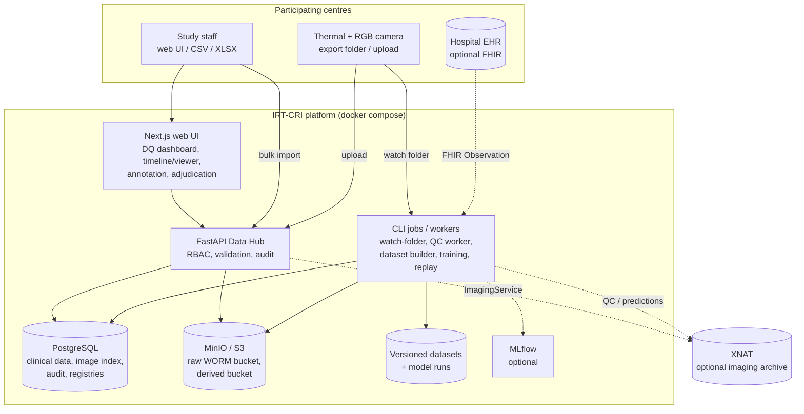
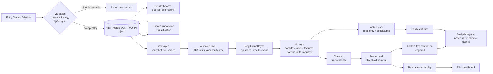

# Architecture

## 1. Principles
- **One Python package (`irtcri`), one web UI, one database.** No microservices. Products A–I are sub-packages that share canonical schemas, so the Data Hub, dataset builder and ML code can never drift apart.
- **Research-grade, extendable to regulated.** Audit trail, immutability, provenance and test-set locking are built in now. Validation documentation and SSO are added later without redesign.
- **Simple infrastructure.** PostgreSQL, S3-compatible object storage (MinIO), FastAPI, Next.js, CLI jobs. No Airflow, Spark, Kafka or Kubernetes: no requirement justifies them at about 100 patients.

## 2. System context and containers

## 3. Data flow (raw → publication)

## 4. Product boundaries (package map)

| Product | Package | Interface |
|---|---|---|
| A Data Hub | `irtcri.hub`, `irtcri.db`, `irtcri.schemas` | REST `/api/v1/...`, `irtcri import` |
| B Imaging + QC | `irtcri.imaging` (+ `integrations.xnat`) | upload API, `watch-folder`, `qc-worker` |
| C Annotation | `irtcri.annotation` | `/api/v1/annotation/...`, UI `/annotate`, `/adjudicate` |
| D Dataset builder | `irtcri.pipeline` | `build-dataset`, `lock-dataset` |
| E ML | `irtcri.ml` | `train`, `evaluate-test`, `replay` |
| F Evaluation/biostatistics | `irtcri.evaluation` | `evaluate-val`, `study-analysis`, `register-analysis` |
| G Interpretability | `irtcri.interpret` | stored with predictions |
| H Pilot dashboard | `hub/routers/dashboard.py`, UI `/patients/[id]` | timeline API |
| I DQ monitoring | `irtcri.monitoring` | `/api/v1/dq/...`, UI `/dq`, `site-report` |
| Integrations | `irtcri.integrations` (FHIR, XNAT) | optional |

## 5. Technical decisions (ADR summary)

| # | Decision | Rationale | Alternatives rejected |
|---|---|---|---|
| 1 | Monolithic package + CLI jobs | small team, ~100 patients; one code path per concept | microservices, Airflow |
| 2 | PostgreSQL (SQLite allowed only in dev/test, enforced) | relational longitudinal model, JSONB, mature backups | document DB |
| 3 | Long-format measurements driven by a YAML data dictionary | new variables need no migration; validation and docs are generated from one source | wide CRF table |
| 4 | Three timestamps + derived availability time | prevents future-data leakage (e.g. labs reported after prediction time) | single timestamp |
| 5 | Write-once raw objects keyed by Study ID + SHA-256 | immutability, deduplication, no PHI in names | mutable file shares |
| 6 | Bearer tokens + RBAC + site scoping now; OIDC/SSO later | works offline in a pilot; SSO depends on the institution | building an IdP |
| 7 | scikit-learn baselines before deep learning; transfer learning for images | ~100 patients is far too few for large models from scratch | ViT-first |
| 8 | Patient-cluster bootstrap for all CIs; event-level early-warning metrics | images are correlated; the clinical question is per event | image-level i.i.d. statistics |
| 9 | MLflow optional; run directory + model card always written | reproducible without extra infrastructure | mandatory tracking server |
| 10 | XNAT optional, dual-write behind `ImagingService` | adds archive value without touching working code | XNAT-only storage |
| 11 | Next.js UI with no component library | small attack surface, few dependencies | heavy UI frameworks |

## 6. Deployment
- **Laptop/dev:** `pip install -e .[dev,ml]`, SQLite + local files; `scripts/run_demo.sh` runs the full SYNTHETIC end-to-end flow.
- **Server/staging:** `docker compose up --build` (PostgreSQL, MinIO with Object Lock bucket, API with automatic Alembic migration, UI). Ports are bound to 127.0.0.1. Put the TLS reverse proxy (`infrastructure/nginx/irtcri.conf`) in front.
- Behind TLS-intercepting proxies, pass the proxy CA as a BuildKit secret (`--secret id=pip_ca,...` / `id=npm_ca`). The CA is never stored in the image.
- Backups: `infrastructure/backup/backup.sh` (encrypted `pg_dump` + object mirror). Test restores quarterly.

## 7. Assumptions (documented, adjustable)
1. Thermal images arrive as vendor exports (CSV/TIFF/NPY), or as palette JPEGs flagged non-radiometric, until a validated radiometric decoder for the chosen camera exists.
2. Imaging interval is per episode (default 12 h) and vitals every 6 h. Completeness metrics use these values.
3. The primary endpoint compares the first model alert with `Outcome.clinical_recognition_time` (conventional detection). The adjudicated onset time is stored separately.
4. The default alert rule is 1 prediction ≥ threshold, a 72 h maximum lead window and a 24 h refractory period. It must be fixed in the SAP before test-set use.
5. Each site keeps its own re-identification key outside this platform.
6. Naive timestamps in imports are in the site's registered timezone. The assumption is stored on the import batch.

## 8. Open questions for the study team
1. Exact reference-standard definitions for ESI/tunnel/pocket infection/CRBSI (IDSA/CDC criteria version), and who adjudicates.
2. Which camera model(s), and whether a radiometric export (CSV/TIFF) is available. This decides whether absolute temperatures exist.
3. Primary prediction horizon (48 h by default) and alert-rule parameters for the SAP.
4. Whether one site is held out for external validation.
5. Data-retention period and data-use-after-withdrawal policy, per the ethics approval.
6. XNAT role (archive of record vs mirror); see `XNAT_INTEGRATION.md` §9.
