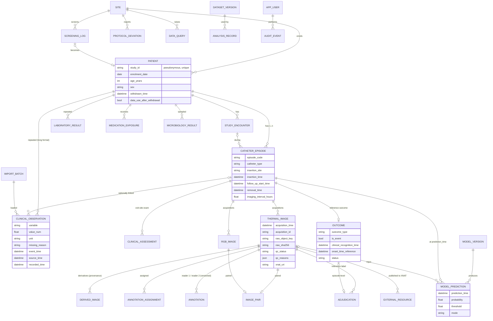

# Data model

Source of truth: `src/irtcri/db/models.py` (SQLAlchemy) + Alembic migrations in `migrations/versions/`
(`0001` initial schema, `0002` analysis registry, `0003` XNAT integration). Variable-level definitions
live in the data dictionary (`configs/data_dictionary.yaml` → `docs/DATA_DICTIONARY.csv`).

## 1. Entity–relationship diagram



All clinical tables also share the `TrackedMixin` columns:

- `recorded_time`, `recorded_by`: when and by whom the row entered this database;
- `source`, `source_ref`, `import_batch_id`: provenance;
- `record_version`: incremented on every correction;
- `is_voided`, `void_reason`: soft delete with a reason;
- `dq_flags`: data-quality flags raised by validation.

## 2. Longitudinal structure

```
Patient (Study ID) ──< StudyEncounter (admission / dialysis attendance)
        │
        └──< CatheterEpisode  (unit of analysis for time-to-event; a patient may have several)
                 ├──< ThermalImage / RGBImage  (acquisition time points; paired into an acquisition_id)
                 ├──< ClinicalAssessment       (standard-of-care exit-site exams = conventional comparator)
                 ├──1 Outcome                  (reference outcome + clinical recognition time)
                 └──< ModelPrediction          (one per image/time point, mode = replay/silent/prospective)
Patient ──< ClinicalObservation / LaboratoryResult / MedicationExposure / MicrobiologyResult
          (patient-level time series; linked to the episode when known, aligned by time otherwise)
```

- **Patient ≠ CatheterEpisode ≠ ObservationTimepoint ≠ ImageAcquisition ≠ ClinicalAssessment ≠ OutcomeEvent.** Each is its own table with its own time stamps.
- Systemic measurements (vitals, labs) belong to the *patient*. The dataset builder aligns them to each episode's prediction times. Overlapping episodes (two lines) are therefore supported without duplicating data.
- Observation time points are not a table. They emerge from measurement timestamps; the protocol grid is used for completeness metrics and `resample_regular()`.

## 3. Time semantics (leakage control)

| Column | Meaning | Example |
|---|---|---|
| `event_time` | when it happened clinically | blood drawn 08:00 |
| `source_time` | when it existed in the source system | lab result reported 11:40 |
| `recorded_time` | when it entered this database | entered 2 days later |
| `available_time` (derived) | when it could have been known at the bedside | `source_time`, else `event_time + dictionary lag` |

- All timestamps are timezone-aware and stored in UTC (`UTCDateTime` rejects naive values at database level).
- Features for a prediction at time *t* use only rows with `available_time ≤ t`. This is asserted on every build (`assert_no_future_leakage`).
- `recorded_time` is deliberately *not* used for availability. Retrospective data entry would otherwise make all data look "late"; it is reported as data latency instead.

## 4. Labels and outcomes
- `Outcome.clinical_recognition_time` is when conventional care recognised the CRI/ESI. It is mandatory for events and is the comparator for the lead time.
- `Outcome.onset_time_reference` is the adjudicated earliest presence of infection (optional). It is used by the `detection` label mode.
- Image samples after recognition are excluded by default: the patient is already treated, and those samples would teach the model post-diagnosis signs.
- Image-level reference labels come only from reader annotations and adjudication, never from the model.

## 5. Corrections, withdrawal and deletion policy
- **Correction:** `PATCH /records/{table}/{id}` with a reason. The previous values are stored in `audit_event.before`.
- **Void:** soft delete with a reason. The row is retained, excluded from analysis layers, but kept in the raw layer for audit.
- **Withdrawal:** blocks new data after the withdrawal time. With `data_use_after_withdrawal = false` the participant is excluded from every dataset and export; the records stay in the hub for the audit trail.
- **Hard deletion** of research records is not available through the software. Erasure obligations are handled by documented DBA procedure after ethics/DPO approval (see `SECURITY_GOVERNANCE.md`).

## 6. Registries
- `dataset_version`: manifests of built/locked datasets.
- `model_version`: model cards and status (`experimental`, `candidate`, `validated_locked`, `retired`).
- `analysis_record`: append-only manuscript provenance.
- `external_resource`: every artefact published to XNAT.
- `import_batch`: file checksum, assumed timezone, per-row issues.
