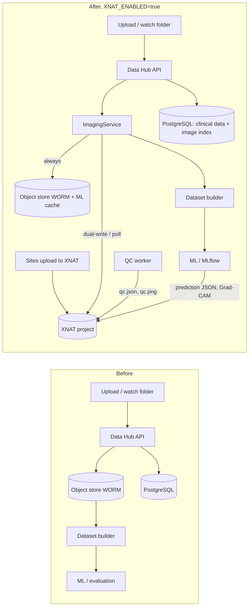

# XNAT integration — audit, decision and design

Status: **implemented as an optional, non-destructive extension** (`XNAT_ENABLED=false` by default).
Nothing that worked before the amendment was removed or rewritten. The platform runs and every existing
test passes with XNAT disabled. With XNAT enabled, 13 XNAT tests pass against a mocked XNAT
(`tests/fake_xnat.py`). An opt-in live suite validates the REST assumptions against a real server.

## 1. Audit of the implementation before the amendment

| Component | State found | Classification | Change made |
|---|---|---|---|
| PostgreSQL clinical database (SQLAlchemy + Alembic) | implemented, tested on SQLite + PostgreSQL 16 | **KEEP AS-IS** | migration `0003` adds 3 nullable image columns + table `external_resource` |
| Patient / encounter / catheter-episode model | implemented | **KEEP AS-IS** | none. The catheter episode is *not* mapped to an XNAT level |
| Thermal image storage (write-once object keys) | implemented (local FS / S3 / MinIO) | **INTEGRATE WITH XNAT** | accessed via `ImagingService` (dual-write); key layout unchanged |
| RGB image storage | implemented | **INTEGRATE WITH XNAT** | as above |
| Image metadata (PostgreSQL rows) | implemented | **KEEP WITH SMALL MODIFICATION** | `acquisition_id`, `xnat_uri`, `xnat_synced_time` added |
| MinIO / S3 | implemented (WORM raw bucket, versioned derived bucket) | **KEEP** (options C + D below) | `list()` added to the store interface |
| Image ingestion (upload, watch folder, adapters) | implemented | **KEEP WITH SMALL MODIFICATION** | storage call goes through the repository; XNAT pull added as a new channel |
| Image QC engine | implemented, configurable | **KEEP AS-IS** | new `qc_worker` reuses it unchanged and publishes QC documents |
| Annotation / blinding / adjudication / IRR | implemented | **KEEP AS-IS** | optional write-back of submitted readings + reference label to XNAT |
| Dataset builder | implemented (leakage-safe) | **KEEP WITH SMALL MODIFICATION** | reads originals through the repository; records `acquisition_id`, `xnat_uri` and image sources in the manifest |
| ML pipeline (F0–F5) | implemented | **KEEP AS-IS** | training never talks to XNAT; it reads versioned dataset files only |
| MLflow | optional tracker (local JSONL fallback) | **KEEP AS-IS** | remains the experiment/model registry. XNAT only receives *copies* of prediction metadata |
| Statistics / evaluation | implemented | **KEEP AS-IS** | none |
| Dashboards (DQ, timeline/viewer) | implemented | **KEEP WITH SMALL MODIFICATION** | images resolved via the repository; acquisition/XNAT status shown |
| Authentication / RBAC | bearer tokens + 8 roles + audit trail | **KEEP AS-IS** | XNAT is accessed with a separate *service account* (env vars) |
| Docker deployment | compose (PostgreSQL, MinIO, API, UI) | **KEEP AS-IS** | XNAT documented as a separate deployment (section 8) |
| Tests | 59 → 72 passing (+1 optional live suite) | **EXTENDED** | mocked XNAT suite |

**No component is classified POSSIBLY REPLACE.** The two candidates were checked and kept:

- The annotation tool: XNAT/OHIF lacks our blinding profiles, enforced reader independence, adjudication workflow, versioning and IRR export.
- The MinIO raw store: still needed offline at the bedside, as write-once evidence and as the ML cache.

## 2. Current design vs XNAT design (decision gate)



1. **What problem does XNAT solve here?** It gives a multicentre study a standard research-imaging archive:
   - per-project access control;
   - a browsable subject/session/scan hierarchy;
   - upload tools that sites and imaging staff already know;
   - one place where reviewers see originals, previews, QC and model artefacts together.

   Later, its Container Service can run the QC worker next to the archive.
2. **Which existing code becomes unnecessary?** None. Three direct object-store calls in ingestion and image loading were replaced by the repository interface.
3. **Which code remains?** All of it: the clinical database, QC engine, annotation, dataset builder, ML, evaluation and dashboards.
4. **How many working modules needed modification?** Six small edits:
   - `imaging/ingest.py`
   - `ml/infer.py`
   - `pipeline/builder.py`
   - `hub/routers/dashboard.py`
   - `core/config.py`
   - `db/models.py`

   Plus one line in the UI. Everything else is new modules.
5. **What is the migration risk?** Low:
   - the migration copies and never moves;
   - it runs as a dry run first and is idempotent;
   - every copy is verified by reading it back from XNAT and comparing SHA-256;
   - every step is audited.

   An XNAT outage never blocks bedside ingestion: the image is kept locally with `xnat_uri = NULL` and pushed later. This is tested.
6. **Is the benefit worth changing the existing implementation?** Yes, **as an optional integration**: real value for multicentre imaging management with no risk to the working data/ML stack. Making XNAT the *only* raw store would be a destructive redesign. That was **not** done and needs your explicit decision (section 9).

## 3. Storage decision

**Chosen: D (optional, both backends supported) + C (the object store keeps ML artefacts).**

- Originals are written to the object store **always** (WORM, works offline, ML cache) and to XNAT **when enabled** (imaging archive for review and multicentre workflows).
- Reads follow `IRTCRI_IMAGING_PRIMARY=object_store|xnat`. Every read is verified against the SHA-256 recorded at ingestion. On checksum failure or unavailability the read falls back to the other backend (tested with a tampered XNAT file).
- Versioned derived ML arrays, Grad-CAM arrays and dataset files stay in the object store and the dataset directory. XNAT receives the human-relevant derived artefacts.
- Upgrade path to option **A** (XNAT authoritative): set `IRTCRI_IMAGING_PRIMARY=xnat` now; reduce local raw retention later by policy. That is a governance decision, not a code change.

## 4. Mapping

| IRT-CRI concept | XNAT construct | Notes |
|---|---|---|
| IRT-in-CRI study | Project `XNAT_PROJECT_ID` | created by the XNAT admin; the platform never creates projects |
| Pseudonymous participant (`study_id`) | Subject, label = Study ID | `subject_label()` refuses anything that is not a Study ID (PHI guard); field `site_code` |
| Acquisition time point | Imaging session, label = `acquisition_id` = `<episode_code>_<YYYYmmddTHHMM>Z` (UTC) | thermal + RGB captured within 2 min share one session; fields `site_code`, `episode_code`, `acquisition_id`, `acquisition_time_utc` |
| Catheter episode | **not an XNAT level** | explicit session field + METADATA JSON; authoritative record in PostgreSQL |
| Thermal source file | Scan `T<sha10>`, type `THERMAL`, resource **RAW** | byte-identical original, write-once (re-upload of different bytes is refused) |
| RGB source file | Scan `R<sha10>`, type `RGB`, resource **RGB** | |
| Temperature matrix | scan resource **THERMAL_MATRIX** (`*_temperature_degC.npy`) | only when temperatures are decodable; lossless float32 |
| Human-viewable heat map | scan resource **PREVIEW** | |
| QC | session resource **QC** (`<scan>_qc.json`, `<scan>_qc.png`) | algorithm + config version, thresholds, timestamp, input checksum, output checksum, software version, git commit |
| Derived imaging | session resource **DERIVED** | Grad-CAM; later registered images, segmentations |
| Model prediction | session resource **PREDICTIONS** | model id/version, dataset version, prediction timestamp, probability, operating threshold, git commit |
| Annotations | session resource **ANNOTATIONS** | submitted readings (reader role, never annotator identity) + current reference label |
| Acquisition metadata | session resource **METADATA** (`<scan>_acquisition.json`) | complete metadata (camera, distance, protocol, checksums), round-trips exactly |

XNAT has no thermal-imaging datatype, so generic types are used: `xnat:otherDicomSessionData` and `xnat:otherDicomScanData`. They are configurable via `IRTCRI_XNAT_SESSION_XSI_TYPE` and `IRTCRI_XNAT_SCAN_XSI_TYPE`. A custom datatype plugin (e.g. `irtcri:thermalSessionData`) is possible later without any platform redesign.

## 5. Thermal file handling

Originals are stored **exactly as received**, whatever the format: radiometric JPEG, JPEG, PNG, TIFF, vendor CSV export, `.npy` or a proprietary file. A radiometric source is never converted and discarded. The temperature matrix and preview are *additional* derived resources, created only when a validated reader (`imaging/readers.py`) can decode temperatures. No camera SDK support is claimed. Radiometric-JPEG decoding needs a site-validated plugin registered in `RADIOMETRIC_PLUGINS`.

## 6. Code layout

```
src/irtcri/imaging/repository.py     ImagingRepository protocol, ObjectStoreImagingRepository, ImagingService
src/irtcri/imaging/qc_worker.py      existing QC engine -> QC document + PNG -> repository (XNAT QC resource)
src/irtcri/imaging/publish.py        prediction / Grad-CAM / annotation write-back
src/irtcri/integrations/xnat/        the ONLY place containing XNAT REST calls
    connection.py projects.py subjects.py sessions.py resources.py upload.py download.py
    metadata.py mapping.py repository.py sync.py (pull from XNAT + migration to XNAT)
scripts/migrate_images_to_xnat.py    python -m scripts.migrate_images_to_xnat --dry-run
tests/fake_xnat.py  tests/test_xnat.py  tests/integration/test_xnat_live.py
```

The client uses `httpx` against the documented XNAT REST API instead of `xnatpy`/`pyxnat`. This keeps a small dependency footprint and a fully mockable transport.

The REST conventions used **must be confirmed on the study's XNAT version** with the live suite; the mocks only prove our own logic. The conventions are:

- `PUT .../experiments/{label}?xsiType=...` to create sessions;
- custom fields as `.../fields/field[name=x]/field`;
- `files/{name}?inbody=true` for uploads;
- `409` returned for an existing file;
- `ResultSet` listings;
- `POST /data/JSESSION` for authentication.

## 7. Workflows and commands

```bash
export XNAT_ENABLED=true XNAT_URL=https://xnat.example.org XNAT_PROJECT_ID=IRTCRI \
       XNAT_USERNAME=irtcri-svc XNAT_PASSWORD='***'        # from the secret store, never committed
irtcri xnat-check                                           # connectivity + project permission
python -m scripts.migrate_images_to_xnat --dry-run          # ALWAYS first: lists study_id/episode/time/sha/target
python -m scripts.migrate_images_to_xnat --report mig.json  # copy + read-back SHA-256 verification; sources kept
irtcri xnat-pull                                            # dry run: images that sites uploaded directly to XNAT
irtcri xnat-pull --commit                                   # register them (needs episode_code + acquisition_time_utc)
irtcri qc-worker                                            # QC documents -> XNAT QC resource (idempotent)
irtcri replay <run_dir>                                     # predictions; JSON + Grad-CAM published when enabled
irtcri xnat-publish-annotations
XNAT_TEST_URL=... pytest tests/integration -m xnat_live     # against a disposable XNAT test project only
```

Which artefact kinds are published is controlled by `IRTCRI_XNAT_PUBLISH` (default `["companions","qc","gradcam","prediction","annotation"]`). Every publication is recorded in `external_resource` with backend, entity, kind, URI and SHA-256.

Safeguards that XNAT does not weaken:

- **Blinding:** blinded annotators never receive `xnat_uri`, because it contains the Study ID.
- **Leakage:** the dataset builder still decides inclusion, labels and splits from PostgreSQL timestamps; XNAT only serves bytes. `test_dataset_builder_reads_images_from_xnat_with_safeguards` deletes all local originals and rebuilds the dataset from XNAT with all leakage assertions active.
- **No guessing:** `xnat-pull` refuses sessions without explicit episode/time metadata.

## 8. XNAT deployment

XNAT is **not** added to this repository's `docker compose`. A production XNAT needs Tomcat, its own PostgreSQL, an archive volume, plugins and institutional authentication. It is better operated as a separate service by the institution's imaging/IT team. For development, the official [`NrgXnat/xnat-docker-compose`](https://github.com/NrgXnat/xnat-docker-compose) works. The platform only needs `XNAT_URL` and a service account with member (read/write data) permission on the project. The existing `docker compose up` workflow is unchanged.

XNAT Container Service integration (running `irtcri qc-worker` automatically on new sessions) is a later deployment step. The worker entry point is already isolated for that.

## 9. Decisions for the study team

1. Is XNAT the archive *of record* for raw images (`IMAGING_PRIMARY=xnat`, then a reduced local retention policy) or a mirror? Until decided, both copies are kept.
2. Should sites upload directly to XNAT (pull workflow) or through the platform (push workflow)? Both are implemented. Pull requires sites to fill `episode_code` and `acquisition_time_utc` at upload; an XNAT upload form or a custom variable set is recommended.
3. XNAT authentication: a local service account now; institutional SSO / alias tokens later.
4. A custom XNAT thermal datatype plugin: only worth it if XNAT-side searching on acquisition fields becomes important.
